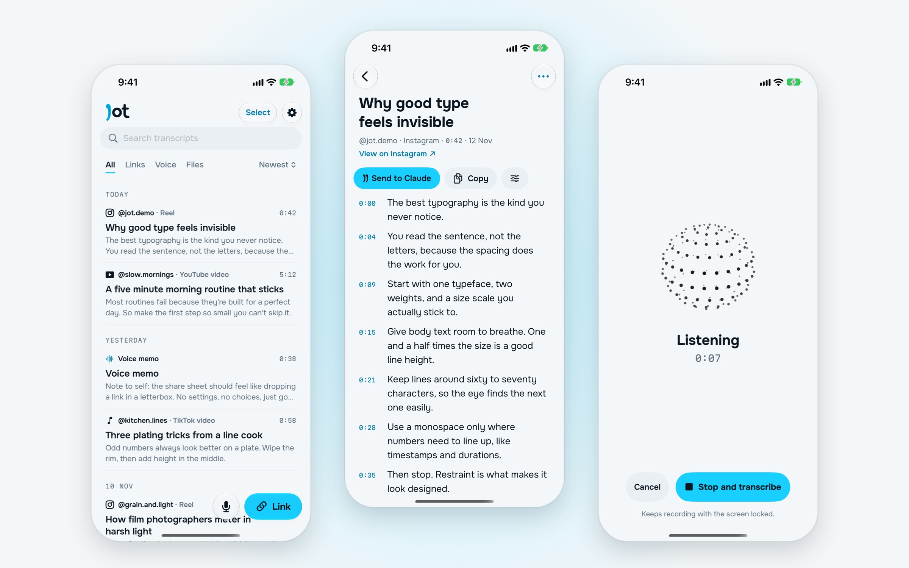
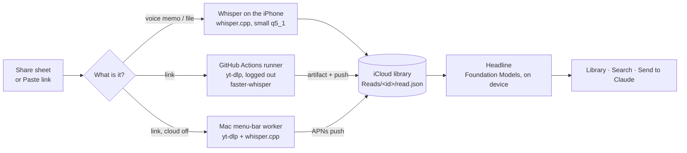
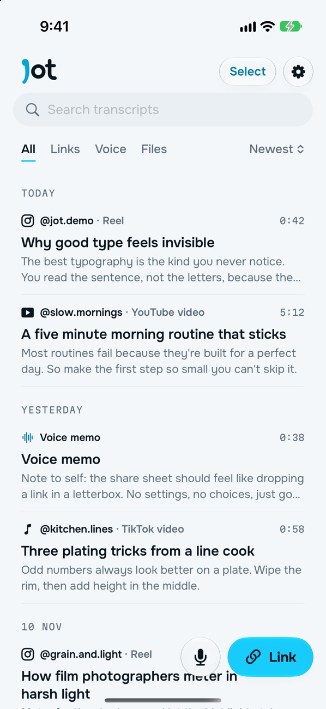
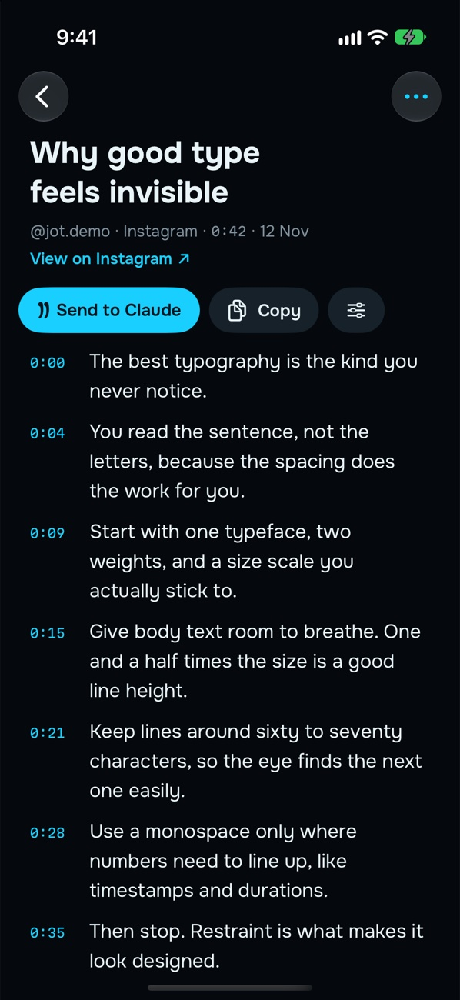
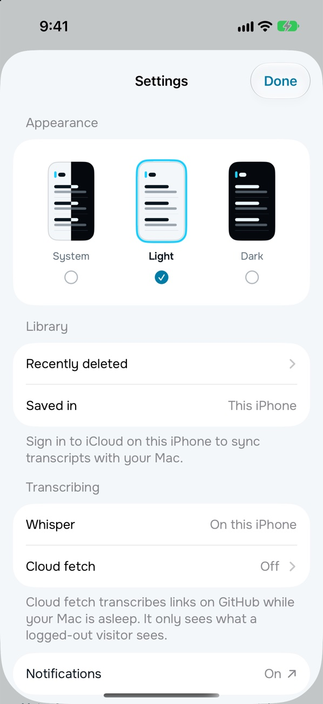
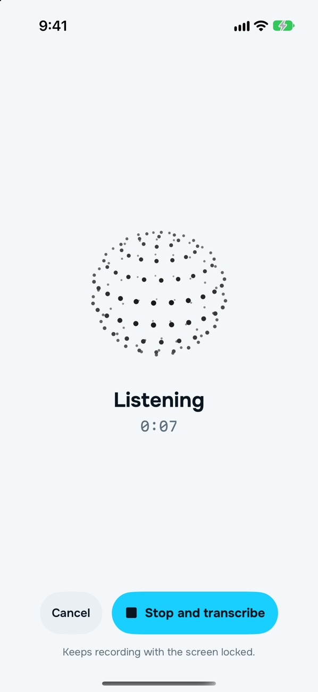

<p align="center">
  <picture>
    <source media="(prefers-color-scheme: dark)" srcset="docs/wordmark-dark.svg">
    
  </picture>
</p>

<p align="center"><b>Speech into words.</b><br>
Share a reel, a video or a voice memo. Get back a clean, timestamped transcript you can search, copy or hand straight to Claude.</p>

<p align="center">
  
  
  
  
</p>

<picture>
  <source media="(prefers-color-scheme: dark)" srcset="docs/hero-dark.jpg">
  
</picture>

## What it does

- **Share anything with a voice in it.** An Instagram reel, a TikTok, a YouTube video, a voice memo or a file. Jot fetches it, listens and writes it down.
- **Timestamps you can tap.** Every line keeps its time, so you can jump straight to the bit you want.
- **Search everything you've ever jotted.** One search field over every transcript, with Links, Voice and Files filters.
- **Send to Claude.** One button hands the transcript to the Claude app, as text or as a file.
- **Record in the app.** Tap the mic, talk, stop. It keeps recording with the screen locked.
- **iPhone and Mac.** The library syncs through iCloud. On the Mac, Jot lives in the menu bar and does the heavy lifting.
- **System, Light or Dark.** Picked in Settings; the share sheet follows it too.

## How it works



**Fetching, logged out.** Links are fetched with [yt-dlp](https://github.com/yt-dlp/yt-dlp) with no cookies and no account, so Jot only ever sees what a logged-out visitor sees. If a post wants a login, Jot says so and asks you to share the video itself.

**Three places to transcribe.**
1. **On the iPhone.** Voice memos and files run through [whisper.cpp](https://github.com/ggml-org/whisper.cpp) (the 5-bit small model plus Silero VAD), downloaded once over Wi-Fi. Until then Apple's `SpeechTranscriber` stands in. Long jobs run as iOS 26 continued-processing tasks, so they finish after you leave the app.
2. **In the cloud.** The share extension dispatches a GitHub Actions workflow ([`server/fetch.yml`](server/fetch.yml)) in a private repo. The runner fetches the post, transcribes it with faster-whisper and sends a "Transcript ready" push. Jot collects the result the next time it opens, then deletes the run. About 40 seconds for a 26-second reel, with no Mac needed.
3. **On the Mac.** A menu-bar app watches the iCloud library for requests, does the work and pushes to the phone through APNs, straight from the Mac, with no server.

**A proofread.** An optional pass with Claude Haiku fixes misheard names and terms. It keeps what Whisper actually heard alongside, so nothing is silently rewritten ([`Cleanup.swift`](JotKit/Sources/JotCore/Cleanup.swift)).

**A headline.** Each transcript gets a short title written on device by Apple's Foundation Models, from the caption and what was said.

**No secrets in the code.** The GitHub token lives in the Keychain (shared with the share extension through the App Group). The APNs key lives in the Mac's login keychain or the runner's encrypted secrets. The Anthropic key comes from the environment or the keychain.

## Design

Jot is a tool: open it, see your transcripts, send one to Claude. Everything that isn't the words gets out of the way.

<table>
  <tr>
    <td></td>
    <td></td>
    <td></td>
    <td></td>
  </tr>
</table>

- **The mark.** The j is a "long comma": a round head running into a curved tail. Two of them side by side make the closing quote mark ” on the app icon.
- **One accent.** Cyan `#18CFFF` is only for things you act on (Paste link, Send to Claude, progress) and for timestamps. Everything else is ink and grey.
- **Two typefaces.** [Onest](https://fonts.google.com/specimen/Onest) for all the text, [Martian Mono](https://fonts.google.com/specimen/Martian+Mono) for times and durations only. Both are open-licence and bundled.
- **No containers.** Inline rows under hairlines, Liquid Glass only on the controls, and text set a step further in than the glass around it.
- **Thinking orbs for waiting.** *Listening* while transcribing, *searching* while fetching, from [ThinkingOrbsKit](https://github.com/Jakubantalik/Libraries.dev).

| Token | Light | Dark |
|---|---|---|
| Background | `#F4F7F9` | `#05090D` |
| Ink | `#0A1620` | `#E8F4F8` |
| Muted | `#5E6F7C` | `#7F909C` |
| Accent | `#18CFFF` | `#18CFFF` |
| Accent text | `#007CA6` | `#18CFFF` |

More in [`design/DESIGN.md`](design/DESIGN.md).

## The code

```
App/            SwiftUI for iPhone and Mac: library, transcript, record, settings, menu-bar worker
Brand/          Colours, type, insets, appearance
Share/          The share extension
JotKit/         Swift package: fetching, Whisper, the library, cloud dispatch, and the `jot` CLI
server/         The GitHub Actions workflow and its Python helpers (transcribe, proofread, push)
tools/          Build to a phone, upload to TestFlight, App Store Connect API helper
```

There's a command-line tool too:

```bash
swift run --package-path JotKit jot read https://www.youtube.com/watch?v=…
```

`jot setup`, `jot read <link|file>`, `jot list`, `jot find <words>` and `jot show <id>` all share the app's library.

## Build it yourself

1. Xcode 26 on macOS 26.
2. Fetch whisper.cpp (a prebuilt XCFramework, about 250 MB, kept out of git):
   ```bash
   JotKit/scripts/fetch-whisper.sh
   ```
3. Open `Jot.xcodeproj`, then change the team, the bundle IDs (`com.kezlahd.jot…`), the App Group and the iCloud container to your own.
4. Build the **Jot** scheme for iPhone or My Mac.

Cloud fetch is optional. Put [`server/fetch.yml`](server/fetch.yml) in a private repo of your own as `.github/workflows/fetch.yml`, then paste a fine-grained token (Actions read and write, that repo only) into Settings › Cloud fetch.

## Credits

- [whisper.cpp](https://github.com/ggml-org/whisper.cpp) and [faster-whisper](https://github.com/SYSTRAN/faster-whisper) do the listening; [yt-dlp](https://github.com/yt-dlp/yt-dlp) does the fetching.
- [ThinkingOrbsKit](https://github.com/Jakubantalik/Libraries.dev) by Jakub Antalik (MIT), vendored unchanged in `App/ThinkingOrbsKit`.
- Onest and Martian Mono, under the SIL Open Font License.

Designed and built by [Kez](https://github.com/KezLahd) with Claude.

The code is here to read and learn from. All rights reserved; ask before reusing it.
